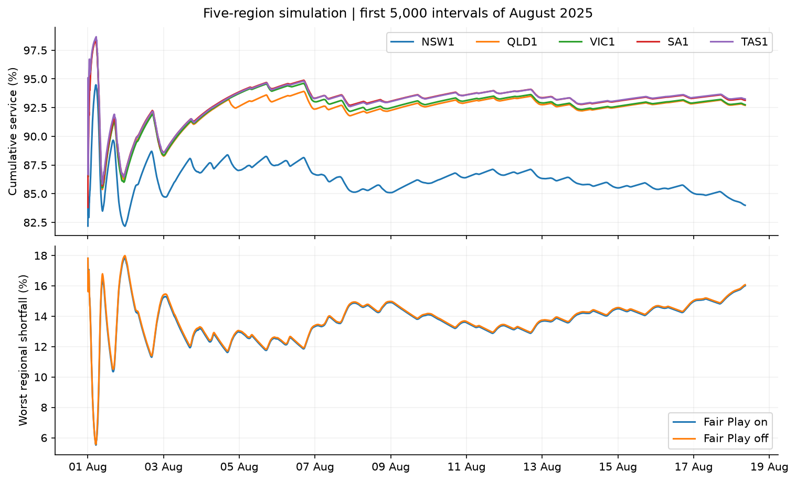
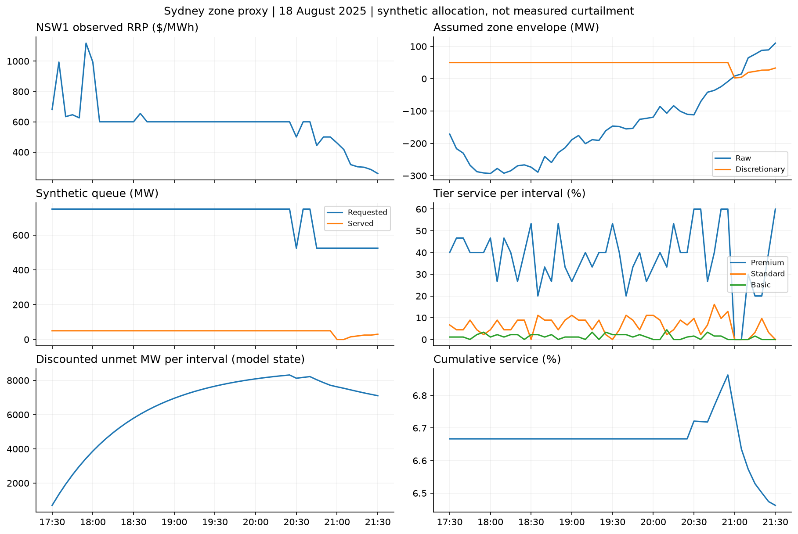

# Fair Play allocation in the Australian NEM

Two research simulations ask who receives discretionary flexibility when requests exceed an assumed MW limit. August 2025 AEMO data describe the market backdrop; the queues, tiers, service limits and allocations are modelled. Neither study changes wholesale dispatch, calculates local settlement prices or measures household curtailment.

**NSW day-ahead case study:** [Two sides of one constraint: 12 October 2026](reports/nsw-2026-10-12/README.md) tests a different question: could a public, cutoff-controlled forecast identify a two-sided flexibility enquiry? The book flagged 23 half-hours and cleared 0 firm MW. Includes a [one-page infographic](reports/nsw-2026-10-12/one-page-infographic.png), [case replay code](reports/nsw-2026-10-12/replay.py), Sydney and Canberra perspectives, a NEMDE comparison and a community-hub design informed by [Power of the Many](https://powerofthemany.org/).

| Study | Question | Result |
|---|---|---|
| [Five NEM regions: method and results](reports/five-regions.md) | Does giving previously underserved regions greater sampling weight change allocation? | In the archived run, the lowest regional service ratio rose by 0.064 percentage points. The pooled model does not establish that power could be transferred between regions. |
| [Sydney metro proxy: method and results](reports/sydney-metro.md) | Which tiers receive service inside one tight, assumed zone limit? | The model served 6.46% of requested energy. Tier weights determined priority; the common zone memory did not differentiate requests within a tier. |




## Reproduce

From the checkout root, create an environment and install the tested dependency versions. The two input extracts and all result traces are included, so no credentials or live services are needed.

```sh
python3 -m venv .venv
. .venv/bin/activate
python -m pip install -r requirements.txt
python verify.py                 # checks archived outputs and replays regional prefixes
python sydney_zone_poc.py        # regenerates both Sydney CSV logs
python charts.py                 # renders all four PNGs using the saved traces
```

For the full seeded regional replays, run `python fpamm.py` (5,000 intervals per mode), then `python tier_backtest.py` (5,200 per mode), then `python verify.py` and `python charts.py`. These runs overwrite the corresponding traces. To rebuild the inputs, extract `DISPATCHREGIONSUM` and `DISPATCHPRICE` file 01 CSVs from the [AEMO August 2025 MMSDM archive](https://nemweb.com.au/Data_Archive/Wholesale_Electricity/MMSDM/2025/MMSDM_2025_08/MMSDM_Historical_Data_SQLLoader/DATA/) to `data/raw/` and run `data_prep_aug2025.py` and `data_prep_price_aug2025.py`. The preparation scripts retain non-intervention records. All times are NEM market time (AEST).

## Interpretation and provenance

This is an adaptation of [Shaun Sweeney's FP-AMM research](https://arxiv.org/abs/2606.17217), not an implementation of its full DC optimal power flow or an independent validation of its fairness theorems. Regional results were checked from the saved full traces and short deterministic replays; the Sydney simulation was rerun end to end. The regenerated charts use the same numerical outputs with captions that identify assumptions. Source market data are attributed to AEMO; this repository is not an AEMO or author-endorsed study.
