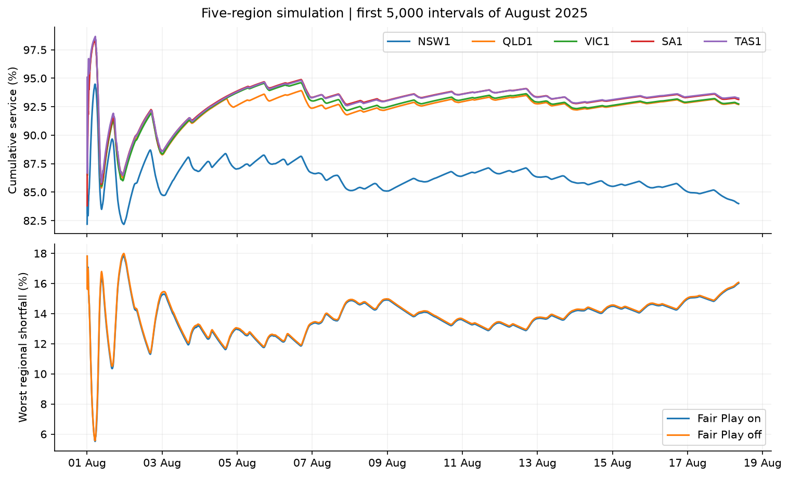
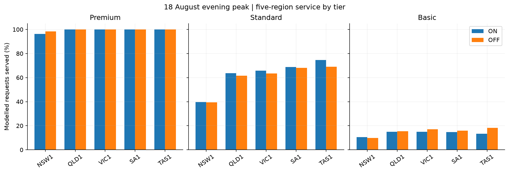
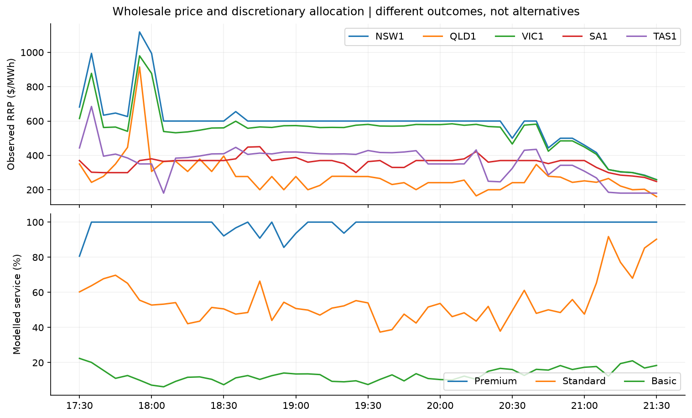

# Five-region proof of concept: does shortage history change who is served?

In a single seeded simulation, enabling regional shortage memory raised NSW's cumulative share of requests served from 83.928% to 83.993%. NSW remained the least-served region. The effect was small compared with the difference between service tiers; it does not establish a robust benefit or a physically deliverable transfer.

## Method

The input was five-minute demand, available generation and net interchange for NSW1, QLD1, VIC1, SA1 and TAS1 from the [AEMO August archive](https://nemweb.com.au/Data_Archive/Wholesale_Electricity/MMSDM/2025/MMSDM_2025_08/MMSDM_Historical_Data_SQLLoader/DATA/). `fpamm.py` synthesises indivisible MW requests, scaled by nominal population weights, with premium, standard and basic probabilities of 10%, 30% and 60%. To stress the smaller regions the model multiplies SA and Tasmanian demand by 1.30 before calculating headroom; this is not recorded demand.

For each interval, the model adds the positive regional headrooms (available generation plus net imports minus adjusted demand) to form a shared pool. A request must fit both the remaining pool and its region's remaining allowance. Regional allowances include half the listed nominal forward capacity of incoming links, not measured spare transfer capability. The model does not route a proposed transfer along a path, impose simultaneous network constraints or re-solve NEMDE.

The allocator draws a non-empty tier with relative weights 4:2:1. Within the tier, each request's weight is proportional to `(0.02 + z_region)^alpha`. Regional memory `z` is an exponentially weighted fraction of unmet requests, clipped to [0,1], with update weight 0.08. Fair Play ON uses `alpha = 1.5`; OFF uses zero. **OFF retains tier priority**: it is not equal service across tiers. The service ratio is cumulative served MW divided by cumulative requested MW; equal five-minute intervals make this equivalent to an energy ratio.

## Results

The 5,000-interval trace covers **1 August 00:05 to 18 August 08:40 AEST**. These are final cumulative service rates from the archived [ON](../results/trace_aug2025_on.parquet) and [OFF](../results/trace_aug2025_off.parquet) outputs.

| Region | ON (%) | OFF (%) | ON minus OFF (percentage points) |
|---|---:|---:|---:|
| NSW1 | 83.993 | 83.928 | +0.064 |
| QLD1 | 92.701 | 92.739 | −0.037 |
| VIC1 | 92.743 | 92.772 | −0.029 |
| SA1 | 93.136 | 93.296 | −0.160 |
| TAS1 | 93.247 | 93.498 | −0.251 |

A **separate 5,200-interval run** extends to 19 August 01:20 and includes the evening peak missed by the shorter run. Across the 49 interval endings from 17:30 to 21:30 on 18 August, aggregate service rates (total served divided by total requested across regions) were:

| Modelled tier | ON (%) | OFF (%) |
|---|---:|---:|
| Premium | 98.47 | 99.36 |
| Standard | 54.41 | 52.96 |
| Basic | 13.08 | 13.68 |

## What the comparison establishes

This run illustrates the trade-off between giving prior shortages a weight and preserving the original allocation. It is not evidence of actual unmet electricity demand, of customer outcomes, or that Tasmania could supply NSW over a saturated interconnector. The availability field is a dispatch input, not spare capacity guaranteed deliverable under all constraints ([AEMO field definitions](https://nemweb.com.au/Reports/Current/MMSDataModelReport/Electricity/Electricity%20Data%20Model%20Report_files/Elec22.htm)).

Only one seed was examined. Queue generation and allocation share a random-number stream; the same starting seed does not guarantee matched requests after ON and OFF paths diverge. A stronger experiment would freeze identical queues across modes, run multiple seeds with uncertainty intervals and enforce interval-specific network constraints before comparing service. The [original FP-AMM paper](https://arxiv.org/abs/2606.17217) uses a different feasibility model.
