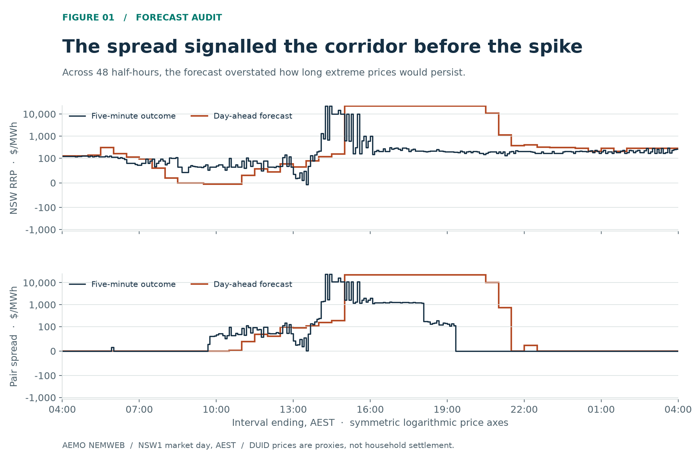
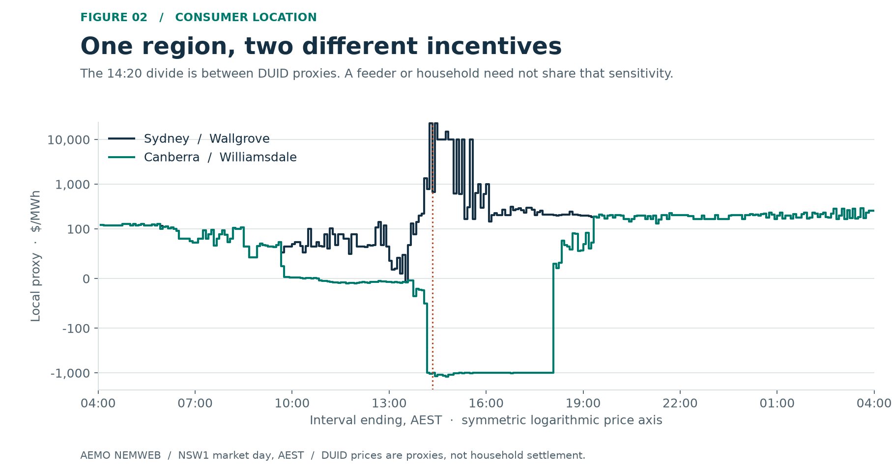

# Two sides of one constraint: a NSW day-ahead shadow market

**Finding:** The public forecast available before 13:00 AEST on 11 October 2026 was good enough to ask for flexibility in the right places on 12 October. It was not good enough to price a firm book, and this study did not show that an automatic market maker (AMM) could dispatch the system more cheaply than NEMDE. Across 48 half-hours we found 23 reasons to seek paired offers, no verified two-sided order and **0 MW of firm trades**. The evidence is a [frozen book](./day_ahead_trade_book.csv) and [five-minute scorecard](./dispatch_scorecard.csv), derived from [AEMO predispatch][PD], [dispatch][D12] and [next-day records][ND].

[Download the one-page infographic](./one-page-infographic.png) · [Run the case](#appendix-reproduce-the-case) · [Inspect the implementation](./replay.py)

## What a day-ahead buyer could have known

The question was not whether someone with hindsight could find a lucrative five-minute trade. It was whether a buyer could identify, by a fixed cutoff, a place and time to seek an extra MW of absorption and an extra MW of export. We tested the previously specified Tumut and Wallgrove route for **every** half-hour of the NSW market day, 04:00 on 12 October to 04:00 on 13 October. This controls data lookahead within the book, not selection of the day, corridor or study question: this was a known congestion event, not a blind trial ([predispatch][PD]; [13 October dispatch][D13]).

The selected public report was labelled 13:00 but generated **12:32:38 AEST** on Sunday 11 October. Its archive-member timestamp was 12:33:04; the next report was generated at 13:02:38 and was excluded. These are archive timestamps, not an independent record of the time any participant downloaded the file. The script writes and hashes its 48-row decision file before it opens dispatch data ([manifest](./manifest.json); [AEMO archive][PD]).

At each interval we asked whether export at the Wallgrove proxy was worth more than absorption at the Tumut proxy, while the monitored `N::N_CNCW_2` constraint carried a material marginal value. An enquiry requested a standard 1 MW on **each** side for 30 minutes. That is a 0.5 MWh transfer before losses, not 1 MWh of additional supply. We did not treat a DUID, its published availability, its dispatch target or a nearby substation as a signed participant offer ([code](./replay.py); [AEMO constraint interpretation][FAQ]).

| Whole-day result | Reading |
|---|---|
| 23 of 48 half-hours flagged | Up to 11.5 MWh on each leg if all enquiries became firm and ran in full. No such energy was contracted. |
| 106 correct flags; 32 false alarms; 11 misses; 139 correct negatives | A half-hour decision was carried into each of its six five-minute intervals. Precision was 76.8%; recall was 90.6%. These are signal scores, not trade success rates. |
| 18 of 23 flagged blocks had at least one qualifying interval | Five flagged blocks never qualified in dispatch. Three of the 25 unflagged blocks qualified at least once. One qualifying five-minute interval does not validate a firm half-hour. |
| $5,815/MWh mean absolute NSW RRP error | Compared 48 forecasts with the corresponding six-price means. At a separate $1,000/MWh spike threshold, only two of 13 high-forecast blocks contained a high actual price; two other blocks spiked unexpectedly. |
| $131,318 forecast gross mark; $17,355 realised-price gross mark | Same hypothetical schedule, different price tapes. The second figure is about 13% of the first. Neither is a payment, a bid-based redispatch saving or a measure of social benefit. |

Calculations use the [archived forecast][PD] and the [12 October][D12] and [13 October][D13] dispatch records, reconciled with the [next-day release][ND]. The quantities, flags and price spreads can be inspected interval by interval in the [book](./day_ahead_trade_book.csv) and [scorecard](./dispatch_scorecard.csv).



## The 14:20 test: right direction, wrong price

The half-hour ending 14:30 had a forecast NSW RRP of $119/MWh and a forecast Tumut to Wallgrove spread of $152.59/MWh. The actual half-hour average RRP was $8,202.01/MWh. The five-minute RRP at 14:20 was $23,107/MWh. The distinction matters: a 30-minute forecast should not be scored solely against a selected five-minute extreme ([predispatch][PD]; [dispatch][D12]).

| AUD/MWh unless noted | Forecast: block ending 14:30 | Actual: interval ending 14:20 |
|---|---:|---:|
| NSW RRP | 119.00 | 23,107.00 |
| Wallgrove, Sydney proxy (`WALGRV1`) | 119.00 | 23,107.00 |
| Tumut, original book absorption proxy (`TUMUT3`) | −33.59 | −1,000.00 |
| Williamsdale, Canberra illustration (`WILLBES1`) | −33.90 | −1,049.05 |
| Wallgrove less Tumut | 152.59 | 24,107.00 |
| Wallgrove less Williamsdale | 152.90 | 24,156.05 |

Prices are RRP plus the published DUID adjustment. Where there is no adjustment row, we use RRP as a proxy and preserve a missing-row flag. Wallgrove has that fallback at 14:20; Williamsdale and Tumut have explicit adjustments. None is a measured household node price or tariff, and Williamsdale was **not substituted into the frozen book** ([public local prices][D12]; [next-day records][ND]; [consumer evidence](./consumer_proxies.csv)).

The named constraint is a Snowy to NSW transient stability limit associated with a Canberra to Capital line outage, not a generic north-south energy shortage. Its 14:20 marginal value was −$24,523.90614/MWh. With RHS and all other quantities frozen, shifting 1 MW of injection from the Tumut sensitivity to Wallgrove reduces this constraint's left-hand side by 0.983 weighted MW. Multiplying gives about $24,107/MWh, consistent with the proxy spread. That is a **local sensitivity**, not permission to dispatch 1 MW. The exact Williamsdale coefficient is 0.985, not Tumut's 0.983. Wallgrove has no explicit energy term in this version of this constraint; that is not a claim of zero sensitivity to every network limit ([effective definition][DEF]; [effective coefficients][COEF]; [dispatch][D12]; [AEMO marginal-value guidance][FAQ]).

One observation makes the feasibility issue concrete. At 14:20 Wallgrove's dispatch target was 41 MW and its published availability was 41 MW. Counting another MW from that unit would double-count capacity; its target was at or above availability in 35 of the 138 flagged five-minute intervals. An independent nearby fleet might respond, but the archive does not establish its location-specific headroom, consent or costs. Neither a dispatch target nor availability is metered generation ([next-day unit records][ND]; [scorecard](./dispatch_scorecard.csv)).

## Two households, one five-minute decision

The two perspectives below assume a 5 kW **incremental** whole-site response for five minutes, or 0.4167 kWh. We assume local wholesale settlement for engaged sites solely for the illustration. An actual tariff, contract, baseline, metered response and available device would be needed before either amount appeared on a bill. The locations describe opposite sensitivities to **this constraint at this time**, not permanent electrical boundaries around either city ([dispatch][D12]; [Williamsdale connection context][ACT]).

| | Sydney: in front of the constraint | Canberra: behind the constraint |
|---|---|---|
| What the customer sees | “I can export 5 kW for five minutes, but will I still have enough stored energy for tonight?” | “My EV is plugged in. Why would I stop charging because the NSW price is high if extra demand here helps?” |
| What the proxy says at 14:20 | Wallgrove export was worth **$23.107/kWh**, about **$9.63 gross** on the stated energy. | At Williamsdale the import proxy was **−$1.04905/kWh**: increasing import earns about **$0.44 gross**, not a $9.63 charge. |
| What happens without a local contract | An ordinary retail export credit need not pass through the spot price. Discharging costs battery life, future recharge and possibly backup reserve. | At full NSW wholesale pass-through, importing the same energy costs about **$9.63** before retail and network charges. A flat-rate customer faces their contract price instead. The local credit is not automatic. |
| What could make the offer firm | An opt-in export tranche above the reserve floor, a permitted export envelope, a minimum net payment and a make-good rule if called. | A metered charging tranche below the import limit, plug-in confirmation, a departure-energy guarantee and a funded credit that covers the change in bill. |

The combined local gross credit would be about **$10.07**. Under the simplified equal-energy regional wholesale comparison, the Sydney sale and Canberra purchase cancel before losses; changing just the Canberra leg from a $9.63 charge to a $0.44 credit leaves a $10.07 funding requirement. A positive spread identifies a reason to look for a beneficiary; it does not create settlement cash. The example assumes no losses, GST, fees or retail hedge effects. No household was identified, metered or paid ([regional dispatch][D12]; [NER v254, rules 3.9 and 3.15][NER3]).



## What the AMM and NEMDE actually solved

There were **not two competing dispatch solutions** in this experiment. NEMDE produced the observed five-minute targets and prices. This interpretation of an AMM used public outputs from AEMO's own forecast to decide where to seek offers. It therefore cannot take independent credit for discovering the underlying constraint. Its contribution is to translate the location signal into a time-stamped, two-sided enquiry and to reject unsupported volume ([AEMO dispatch information][NEMDE]; [frozen book](./day_ahead_trade_book.csv)).

| Question | NEMDE / observed market | NSW shadow AMM interpretation |
|---|---|---|
| What is selected? | Dispatch targets for scheduled resources and market ancillary services, subject to the dispatch inputs and constraints. | Whether to seek two incremental offers; a standard enquiry size; a firm book of zero. No power-flow solution or new target. |
| What is optimised? | Value of spot trade based on bids: consumption value less bid-based production, demand response, network and ancillary-service costs, subject to the rule. This is not knowledge of every participant's true cost. | No cost or welfare objective was optimised. A spread-and-constraint filter ranks direction implicitly; it does not find the best quantity, price, route or fairness allocation. |
| What makes it feasible? | AEMO models balance, availability, dispatch and security constraints, interconnectors and ancillary services. Conflicting constraints have prescribed relaxation procedures. | One named constraint screened at forecast prices. No full constraint set, FCAS interaction, feeder solve, time-linked battery state or reserve check. Opposite MW legs do not guarantee feasibility. |
| How is a price used? | Regional spot prices inform wholesale settlement under the NER. A constraint marginal value measures sensitivity to a marginal relaxation of that constraint. | Forecast and realised DUID proxy prices mark an assumed incremental position. No wholesale settlement, binding quote, escrow, inventory or budget-balanced allocation. |
| What does fairness mean? | The dispatch objective is defined by the rules; this is not an allocator of household service-history entitlements. | The earlier repo experiments used service tiers and shortage memory. This NSW screen did **not** run that allocator; no household fairness or reliability result follows. |

Sources: [NER v254, especially 3.8.1, 3.9 and 3.15][NER3]; [AEMO dispatch procedures][NEMDE]; [AEMO on constraint marginal values][FAQ]; [regional implementation](../../fpamm.py); [case implementation](./replay.py).

**What would constitute a fair contest?** Reproduce the baseline targets, prices, binding constraints and objective from identical interval case inputs. Then add the *same* verified bids, locations, distribution envelopes, FCAS obligations, losses, SoC and terminal energy requirement to both cases. Compare ordinary least-bid-cost allocation with an AMM-mediated allocation and, separately, with any fairness constraint switched on. Re-solve the dispatch and run a distribution feasibility check; do not multiply a fixed shadow price by progressively larger volumes. If the objective and feasible set are identical and the baseline is solved optimally, a different matching rule cannot deliver a strictly better value of that same objective. A gain must come from new capability, better information, lower transaction costs or a deliberately different objective. A distributional improvement may be worth paying for; it should not be reported as a cost saving.

## Who gains, who pays and who could lose

No-one won or lost money **from this replay**. The table distinguishes plausible effects of a future funded arrangement from money changing hands in the historical market. The relevant comparison is what each party would have done without the programme, not an assumed zero baseline ([frozen book](./day_ahead_trade_book.csv); [settlement framework][NER3]).

| Party | Potential gain | Potential loss or transfer | Test before calling it a benefit |
|---|---|---|---|
| Sydney exporter / flexible load | Credit for verified incremental export or avoided import when locally valuable. | Degradation, rebound, loss of reserve, non-delivery charges or sacrificing a higher-value later action. | Net household bill plus battery and reserve costs against its own baseline. |
| Canberra absorber / local generator | A flexible load gains a credit; local generation might avoid curtailment if redispatch permits. | Unhedged wholesale import can be expensive; a generator need not receive a better price, and avoided curtailment is not established. | Meter both legs, track the make-good payment, and re-solve generation and curtailment. |
| Renters, non-owners and non-participants | Could access a community asset or benefit from genuine avoided costs. | Could fund participant credits through tariffs or residual charges without receiving a share. | Publish costs and benefits by cohort, including customers with no flexible asset. Require a no-cost participation option in any equity trial. |
| Retailer, aggregator and funding counterparty | Aggregation may reveal smaller offers; a contracted beneficiary may buy risk reduction. | Basis risk, imbalance, collateral, retail hedges and performance guarantees can absorb the spread. Both proxy legs can be owed money simultaneously. | Name the payer and beneficiary, cap exposure, reconcile wholesale and retail cashflows, and specify who carries default. |
| Incumbent generators, storage and network users | Less congestion may help some constrained resources; flexibility may defer a specific investment if dependable. | Redispatch may displace another generator or erode scarcity rents. Network limits or congestion may shift. A lost rent is not automatically a resource saving. | Reprice all affected parties, test other constraints, compare multi-year avoided network cost with procurement cost. |
| AEMO, networks and consumers collectively | Better visibility of previously unoffered flexibility and a more credible demand forecast. | Extra operating complexity, correlated non-delivery or double counting with FCAS and other programmes. AEMO is not a default purchaser of the spread. | Separate resource-cost, operator, participant, network and emissions ledgers. Reconcile transfers to zero across all parties. |

## Power of the Many: what a community hub could contribute

[Power of the Many](https://powerofthemany.org/) describes local sharing of solar, batteries and flexible demand behind one connection, with open standards and a member view of use, contribution and benefit. Its [DENYSE project](https://powerofthemany.org/denyse) describes collective ownership and a distributed ledger; its [European sandbox work](https://powerofthemany.org/eu-sandbox) concerns membership, governance and treasury. These are useful design references, **not** evidence that its platform ran this replay, that its operators endorse FP-AMM, or that European permissions apply in Australia.

| Design to borrow | Application to this case | Boundary to preserve |
|---|---|---|
| Orchestrate behind a connection | First net member needs, backup and departure reserves inside each hub. Offer only the remaining whole-connection import or export tranche. | Two independently certified hubs are needed. Sharing inside one connection does not move energy around the NSW transmission constraint. |
| Let members see contributions and benefits | Give each Sydney and Canberra participant a statement of baseline, response, credit, fees and the difference from their ordinary bill. Publish an aggregate non-participant ledger. | Local allocation is contractual accounting. It is not a change to AEMO's spot price or proof that particular electrons travelled between members. |
| Collective access and governance | Trial a no-upfront-cost share of a community battery for renters or households without DER. Let members choose reserves and contest allocations. | Do not equate token ownership with a physical dispatch right, or wealth with service priority. A simple auditable ledger suffices for this trial. |
| Coordinate with the network operator | Each hub supplies a timestamped operating envelope and a firm price/quantity curve. A separate market-facing participant checks both legs and the funding contract. | An open protocol is useful; it cannot certify grid security, satisfy registration requirements or create the missing settlement payer. |

There is also a useful tension. A Canberra hub might increase local consumption both to absorb surplus and to relieve the monitored constraint; a Sydney hub maximising only self-consumption might **withhold** the export the system needs. A two-hub trial should therefore compare local-only optimisation with a priced external flexibility offer, preserving each member's reserve and right to decline. That tests whether coordination adds value above the community's existing service, rather than crediting the proposed AMM with all benefits of local sharing ([Power of the Many's local-sharing model](https://powerofthemany.org/p2p-energy-sharing); [NSW local-price evidence][D12]).

## Australian objectives and rules

The relevant statutory test is the **long-term interests of consumers**, not whether two participating asset owners can collect a positive gross spread. Section 7 of the National Electricity Law addresses efficient investment, operation and use; price, quality, safety, reliability and security of supply; reliability, safety and security of the national electricity system; and participating jurisdictions' emissions targets. The National Energy Retail Objective also matters for the household-facing design. The gas objective is not engaged by this electricity-only replay ([AEMC national energy objectives][NEO]).

| Objective | Assessment on the evidence | Evidence required for a favourable finding |
|---|---|---|
| Efficient operation and consumer price | **Plausible, unproved.** The sign was informative; no trade, bill reduction or lower dispatch objective was demonstrated. | Bid-based redispatch, true incremental resource costs where known, all-in bill impacts and non-participant funding. |
| Efficient investment and use | **Unproved.** A single operating day cannot justify a battery, a network deferral or a standing procurement budget. | Compare dependable delivered MW over recurring conditions with network and non-network alternatives, including opportunity cost. |
| Quality, reliability, safety and security | **Not established.** Reducing one stability constraint is directionally useful. It is not an improvement in voltage quality, system security or continuity of supply. | Feeder voltage, thermal and protection checks; outage and contingency studies; device safety, correlated failure and rollback; no sacrifice of essential household reserves. |
| Jurisdictional emissions targets | **Indeterminate.** Local charging can use surplus renewable energy, but losses, displaced generation and later recharge can reverse the result. | Time-linked incremental dispatch and emissions factors against the no-trade case, including energy recovery; state which target is relevant. |
| Retail consumer interests and distribution | **Conditional.** Voluntary local credits may improve choice but complexity and asymmetric risk may harm households. Fairness is a design choice, not a statutory finding. | Informed consent, tariff comparator, exit and complaints process, protections for vulnerable customers and a transparent funding allocation. |

For the event-date assessment use **NER version 254**, effective 4 September 2026, not a later compilation ([AEMC version history][HIST]; [version 254][NER]). This is a design assessment, not legal advice or a finding of compliance.

| Rule or framework | What it means for the proposed design |
|---|---|
| NER 3.8.1 and Chapter 4: central dispatch and security | AEMO operates central dispatch. A retrospective enquiry is not a dispatch instruction. A physical trial must respect applicable targets, constraints and directions; a private match cannot override them ([Chapter 3][NER3]; [NER v254][NER]). |
| NER 3.8.22A: false or misleading bids and rebids | An indicative enquiry must not be represented as a firm dispatch bid. Validate intent, availability and permissions before a registered participant bids. A floor price alone is not proof of misconduct ([Chapter 3][NER3]). |
| NER 3.9.2, 3.15.6 and 3.6.5: spot prices, spot transactions and residues | Keep existing wholesale settlement intact in a private overlay, with a separate contractual credit. Do not appropriate settlement residue or assume AEMO funds it. Replacing official regional settlement for engaged sites is a different proposal requiring explicit authority ([Chapter 3][NER3]). |
| NER Chapters 2, 5/5A and 7: registration, connection and metering | Determine the registered and financially responsible parties, approved connection limits, meter boundary and conformance method. A DUID proxy and retail telemetry are not automatically settlement-grade evidence ([NER v254][NER]). |
| IPRR and retail protections | IPRR provides a pathway for eligible aggregated resources to participate in dispatch; it is not authorisation for private nodal settlement. Confirm commencement, eligibility, retailer contracts, consent, jurisdictional protections and any exemption or waiver before starting a paid trial ([AEMC final rule][IPRR]; [retail objective][NEO]). |

## Recommendation: the next experiment

Proceed to a **two-hub shadow procurement**, not a live settlement change. Ask a Sydney and a Canberra portfolio for simultaneous, timestamped price/quantity offers, reserve limits, agreed baselines and network envelopes. Give both a no-trade option. A blinded set of ordinary, congested and false-alarm days should be registered in advance, with a separate holdout period and thresholds fixed before scoring.

Compare four cases: observed dispatch; a validated no-trade rerun; the same rerun with both new offers available to conventional dispatch; and those identical offers subject to the proposed AMM allocation. Add a fifth, local-only community sharing case if the hubs already optimise behind their meters. Publish matched and delivered MW, unmet service by household cohort, cost of fairness, cashflows by payer, rebound and emissions. Report “not assessable” wherever inputs are missing. **Advance only if** an independent check finds the trades deliverable, a payer accepts the residual, non-participants are protected and the claimed net benefit survives a like-for-like comparison.

## Appendix: what was implemented and what was not

### Upstream research, repository adaptation and this case

The upstream **research is published**: the [market architecture paper][ARCH] describes continuous event-driven coordination, nested scarcity signals and a settlement design; the [Fair Play paper][FP] describes two-stage stochastic allocation with bounded shortage memory and a DC optimal-power-flow feasibility set. The author's [public project description][EN] also discusses holarchical coordination and Shapley-based settlement. **This repository contains an independent interpretation, not the upstream AMM implementation.** No released upstream executable was used or verified for this study. Publication of the papers must not be confused with publication of production source code or endorsement of this report.

| Component | Earlier code in this repository | This NSW historical replay |
|---|---|---|
| Allocation | [Five-region code](../../fpamm.py) samples an eligible service tier with weights 4:2:1, then a request using its region's shortage-memory score. It uses a shared pool and nominal regional allowances; it is not a full-network DC-OPF. The [Sydney study](../sydney-metro.md) has a common zonal memory, so it cannot differentiate service history within a tier. | No stochastic draw, service tier, preference ordering, fairness guarantee or FP on/off comparison. It tests offer discovery, not Fair Play allocation. |
| State and prices | The regional model implements a bounded scarcity signal and updates shortage memory as `clip((1-beta)*z + beta*shortage, 0, 1)` with default `beta=0.08`. Its synthetic requests are not NEM bids. | No endogenous AMM price curve or inventory. Reads published regional price and DUID adjustments, then applies a deterministic bilateral screen. |
| Network and settlement | The [regional](../five-regions.md) and Sydney experiments are synthetic rationing studies informed by AEMO data, not alternate settlements. Paper-level guarantees do not transfer to those approximations. | No clearing solver, market-making inventory, Shapley allocation, member ledger, authoritative household prices, token system or market settlement. Prices are marked ex post only for evaluation. |

### Reconstruction and safeguards

1. **Select the vintage.** Enumerate member ZIPs in the weekly predispatch archive. Require both generation and member timestamps at or before the cutoff; check the embedded report header. Non-intervention records only. Input provenance and SHA-256 are in the [manifest](./manifest.json).
2. **Freeze decisions.** Read `REGION_PRICES`, `REGION_SOLUTION`, `LOCAL_PRICE`, `INTERCONNECTOR_SOLN` and `CONSTRAINT_SOLUTION`. For each half-hour use `proxy = RRP + DUID adjustment`, with an explicit row flag and zero-adjustment fallback. Enquire if `Wallgrove proxy - Tumut proxy > 0.01` AUD/MWh and `abs(monitored marginal value) > 0.01`. Thresholds remove numerical noise; neither covers transaction costs. Set indicative MW to one per leg if true, otherwise zero. Firm MW is always zero because no participant book was supplied. Save and hash the book before reading realised data ([code](./replay.py); [forecast source][PD]).
3. **Score without changing the book.** Align six successive five-minute interval endings with each block. Use DispatchIS and next-day local-price/constraint feeds; assert overlapping values agree. Keep a missing-row flag separate from an observed zero. Read the Wallgrove target and availability from `UNIT_SOLUTION`, not a bid or a meter. The city extension emits `WILLBES1` and `WALGRV1` evidence without entering the trading decision ([scorecard](./dispatch_scorecard.csv); [city records](./consumer_proxies.csv); [dispatch][D12]; [next-day data][ND]).
4. **Value, do not settle.** Forecast mark equals the sum of flagged half-hour spread × 1 MW × 0.5 h. Realised mark equals the sum of signed five-minute spreads for exactly those flagged blocks × 1 MW × 1/12 h, including intervals that did not qualify ex post. No favourable intervals are cherry-picked. No real trade, cost saving, actual customer benefit or headroom is inferred ([offline tests](./verify_case.py)).

### Appendix: reproduce the case

From this directory, `python verify_case.py` checks the committed evidence without network access. To regenerate, download the four ZIPs in [manifest.json](./manifest.json) into one directory, retaining their original filenames. The weekly predispatch ZIP is large; raw archives are not included in Git. Run:

```sh
python replay.py /path/to/aemo-zips
python verify_case.py
python -m pip install -r ../../requirements.txt
python figures.py
```

`replay.py` and `verify_case.py` use Python's standard library. `figures.py` reads the committed CSVs and renders two symmetric-log price charts plus the one-page PNG. The regression test checks the original book hash, market-day alignment, classification counts, gross marks and both city examples. No credentials, control interfaces or private site data are required. No HAEO controls or upstream code were changed.

[PD]: https://nemweb.com.au/Reports/ARCHIVE/PredispatchIS_Reports/PUBLIC_PREDISPATCHIS_20261011_20261017.zip
[D12]: https://nemweb.com.au/Reports/ARCHIVE/DispatchIS_Reports/PUBLIC_DISPATCHIS_20261012.zip
[D13]: https://nemweb.com.au/Reports/ARCHIVE/DispatchIS_Reports/PUBLIC_DISPATCHIS_20261013.zip
[ND]: https://nemweb.com.au/Reports/CURRENT/Next_Day_Dispatch/PUBLIC_NEXT_DAY_DISPATCH_20261012_0000000542594175.zip
[DEF]: https://nemweb.com.au/Data_Archive/Wholesale_Electricity/MMSDM/2026/MMSDM_2026_09/MMSDM_Historical_Data_SQLLoader/DATA/PUBLIC_ARCHIVE%23GENCONDATA%23FILE01%23202609010000.zip
[COEF]: https://nemweb.com.au/Data_Archive/Wholesale_Electricity/MMSDM/2026/MMSDM_2026_09/MMSDM_Historical_Data_SQLLoader/DATA/PUBLIC_ARCHIVE%23SPDCONNECTIONPOINTCONSTRAINT%23FILE01%23202609010000.zip
[FAQ]: https://www.aemo.com.au/energy-systems/electricity/national-electricity-market-nem/system-operations/congestion-information-resource/constraint-faq
[NEMDE]: https://www.aemo.com.au/energy-systems/electricity/national-electricity-market-nem/market-operations/dispatch-information
[ACT]: https://www.aer.gov.au/news/articles/communications/aer-grants-evoenergy-ring-fencing-waiver
[NER]: https://energy-rules.aemc.gov.au/ner/818
[HIST]: https://energy-rules.aemc.gov.au/ner/historic
[NER3]: https://aemc-dra-production-s3.s3.ap-southeast-2.amazonaws.com/public/rules/bc0d2a8e1cf523289a553dfefbec0a3b359f4b5b/assets/files/NER%20-%20v254%20-%20Chapter%203-cover.pdf
[NEO]: https://www.aemc.gov.au/regulation/neo
[IPRR]: https://www.aemc.gov.au/rule-changes/integrating-price-responsive-resources-nem
[FP]: https://arxiv.org/abs/2606.17217
[ARCH]: https://web3.arxiv.org/abs/2512.13871
[EN]: https://enleashed.tech/
