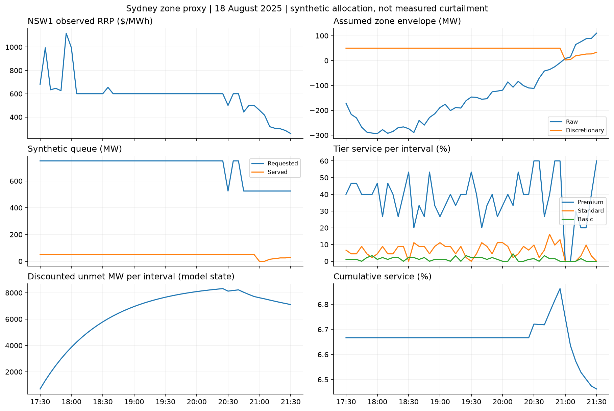

# Sydney metro proof of concept: service within one zone

Over the 18 August 2025 evening peak, the allocation model served **184.58 MWh of 2,856.25 MWh requested (6.46%)**. These are simulated discretionary requests. Neither the shortfall nor the tier results represent metered households, actual load shedding or an AEMO instruction.

## Method

`sydney_zone_poc.py` takes 49 five-minute interval endings from 17:30 through 21:30 AEST. Regional demand, dispatchable generation, net interchange and NSW1 RRP come from the [AEMO August 2025 archive](https://nemweb.com.au/Data_Archive/Wholesale_Electricity/MMSDM/2025/MMSDM_2025_08/MMSDM_Historical_Data_SQLLoader/DATA/). The observed NSW1 RRP peaked within this window at $1,118.93/MWh at 17:55. It is a regional price, not a measured Sydney node price.

The `NSW_SY` proxy includes Sydney, Snowy and Coast. Modelled demand is 32% of NSW demand. Local supply is `2200 × 0.9 × min(1, NSW dispatchable generation / 11000)` MW. Transfer into the zone is the smaller of 1,800 MW and the non-negative sum of NSW net imports and 60% of NSW dispatchable generation. Raw envelope equals estimated local supply plus transfer minus zone demand. None of these zone quantities is measured headroom.

When the raw envelope is non-negative, 30% is made available for discretionary service. When it is negative, the model instead assigns `max(50 MW, 5% × absolute deficit)`. **This is an imposed scenario allowance:** even a negative raw envelope can therefore produce 50 MW of simulated service. It does not demonstrate that a network operator could safely deliver it.

At NSW RRP above $500/MWh, the model requests 750 MW; otherwise it requests 525 MW. It splits the synthetic queue into 5 MW blocks, with an approximate 10:30:60 tier mix. It draws non-empty tiers with weights 4:2:1, samples uniformly within the chosen tier, and accepts only whole blocks fitting the discretionary allowance. Seeds are 42 (requests) and 7 (clearing).

## Results

Energy equals the sum of the power values at the 49 interval endings divided by 12. This includes the five-minute interval ending at 17:30, not just intervals starting at or after 17:30.

| Tier | Requested (MWh) | Served (MWh) | Service rate |
|---|---:|---:|---:|
| Premium | 283.33 | 107.08 | 37.79% |
| Standard | 854.58 | 55.00 | 6.44% |
| Basic | 1,718.33 | 22.50 | 1.31% |
| **All tiers** | **2,856.25** | **184.58** | **6.46%** |

The raw zone envelope ranged from −293.35 to +109.99 MW; the constructed discretionary allowance ranged from 2.47 to 50.00 MW. At less than 5 MW even one block could not fit. The model's shortage memory peaked at 8,315.12 at 20:25 and ended at 7,105.26. Its units are accumulated, discounted per-interval MW shortfalls, not MWh or a percentage.

## Interpretation and audit

All requests in a given tier and interval share one zone memory value. The code logs the implied priority score but draws uniformly within that tier: **the observed tier differences do not demonstrate an effect of inverse-fairness weighting**. The implemented memory update is `max(0, 0.92 × previous memory + unmet MW)`, without an upper clip. Unlike the [paper's bounded shortage memory](https://arxiv.org/abs/2606.17217) and the regional implementation, this state is not constrained to [0,1]. No long-run fairness convergence is established by this run.

The [state log](../results/sydney_zone_state_log.csv) covers every interval; the [iteration log](../results/sydney_zone_iter_log.csv) records six selected intervals, not the whole window. The next useful test is to replace the assumed allowance with a validated network envelope, retain distinct requester histories and compare service with memory on and off using identical arrivals.
