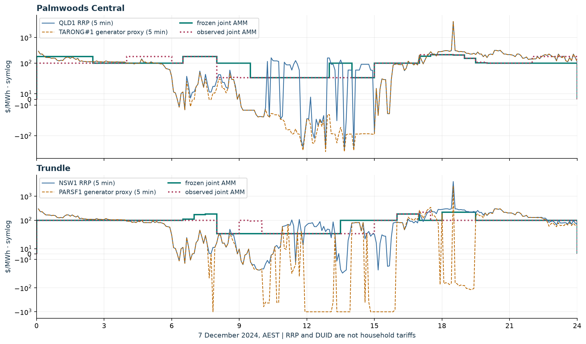
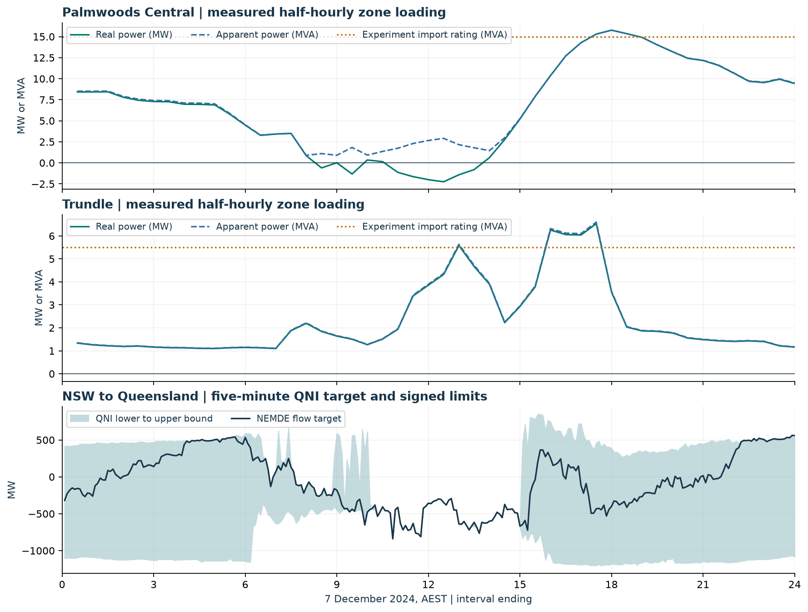
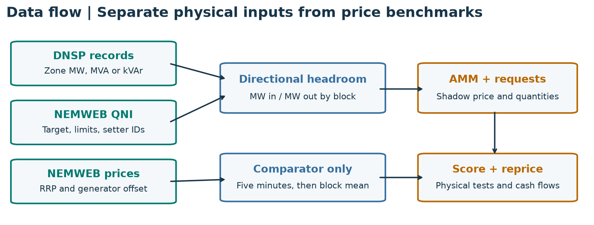
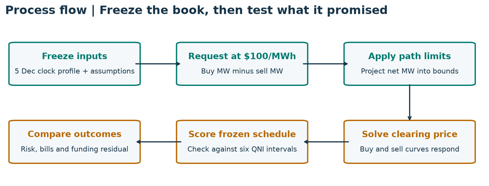

# Can a local AMM clear household flexibility across transmission and distribution limits?

**7 December 2024, Palmwoods Central (Energex, QLD1) and Trundle (Essential Energy, NSW1).** A shadow AMM priced the same flexible requests differently at the two zones. The important result was not the difference in price: the day-ahead schedule exceeded the reconstructed transfer envelopes in **16 of 48 half-hours at Palmwoods Central and 4 of 48 at Trundle**. Matching more locally reduced exposure, but neither a generator price nor a day-old network envelope made a firm household trade.

This folder contains the executed experiment, not just a proposal. It compares actual NEMDE price outcomes with a separate, deliberately simple AMM interpretation. No actual offers, dispatch, customer bills, site controls, or NEM settlements were changed. The sites are **independent experiments**, not two ends of a simultaneously cleared trade.

## Result at a glance

Daily arithmetic means, $/MWh; each AMM price applies to buys and sells. Five-minute benchmarks cover 288 intervals per region, while the shadow AMM clears 48 half-hours. “Frozen” means a persistence scenario fixed before the study day; “observed” means a hindsight re-clear, not a forecast.

| Zone | Actual regional RRP | Generator local-price benchmark | Frozen joint AMM | Observed joint AMM | Frozen blocks outside joint limits | Excess energy |
|---|---:|---:|---:|---:|---:|---:|
| Palmwoods Central | 118.06 | 93.98, Tarong unit 1 | 111.76 | 111.20 | 16/48 | 5.92 MWh |
| Trundle | 111.05 | -67.87, Parkes Solar Farm | 99.79 | 90.18 | 4/48 | 3.05 MWh |

**Where the prices parted company:** at 18:30 AEST the actual five-minute RRPs were $4,169.15/MWh in QLD1 and $4,127.15/MWh in NSW1. For the half-hour ending then, the RRP averages were $945.88 and $934.08 respectively. Both frozen AMMs quoted $214.00. Under the observed inputs Palmwoods stayed at $214.00 because its modelled distribution import headroom was zero. Trundle fell to $100.00 because its 1.9 MW net request fitted both limits. The AMM is not forecasting the regional spike and has no mechanism here to pay its full wholesale opportunity cost. See [market observations](market-inputs.csv) and [interval solutions](interval-results.csv).



## Experiment design and inputs

**Question.** Does combining a nominated upstream transfer constraint with a downstream transformer screen change the local price, the gross volume matched and the net energy crossing the boundary? Does a book frozen before the day remain within those limits when the actual traces arrive? To isolate the layers, each case uses the identical request book, base price and response coefficients.

| Source | Input and transform | What it cannot tell us |
|---|---|---|
| [Energex load archive](https://www.energex.com.au/our-network/network-data/zone-substation-load-data) | Palmwoods Central secondary-side half-hour MW and MVA. On 7 December real power ranged from **-2.25 to 15.77 MW**. Retain sign; infer only the magnitude of reactive power from apparent power. | Reverse flow is not an overload. The files do not identify a phase voltage, switch state or actual transformer outage. |
| [Energex limitations](https://www.energex.com.au/__data/assets/excel_doc/0010/1841365/Limitations_not_addressed_-_Energex_2025.xlsx) and [bulk supply workbook](https://www.energex.com.au/__data/assets/excel_doc/0009/1841148/Bulk_Substations_Load_Forecast_-_Energex_2025.xlsx) | Planning chain: Palmwoods 132 kV connection point → Nambour bulk supply → Palmwoods Central. The named loss of a 15 MVA transformer motivates a **15 MVA stress scenario**, with a 30 MVA sensitivity. | These scenario magnitudes are not verified operating limits on the day. Neither workbook supplies the Palmwoods-to-QNI marginal load coefficient. |
| [Essential zone archive](https://www.essentialenergy.com.au/our-network/network-projects/zone-substation-reports) and [seasonal planning workbook](https://dapr.essentialenergy.com.au/DAPR%202025%20BSP,%20ZS%20and%20Lines%20Extract%20Summary.xlsx) | Trundle, Parkes planning region: convert half-hour kW and kVAr to MW and MVAr; calculate MVA. Event-day real power was **1.097 to 6.533 MW**. Use summer firm normal cyclic 5.5 MVA as a retrospective stress case. The 13 MVA sensitivity sums 8 and 5 MVA nameplates only. | Firm and installed ratings are different. The later planning workbook is not evidence of an outage in 2024, an export permission or a verified transmission path to Parkes Solar Farm. |
| [AEMO December 2024 MMS archive](https://nemweb.com.au/Data_Archive/Wholesale_Electricity/MMSDM/2024/MMSDM_2024_12/MMSDM_Historical_Data_SQLLoader/DATA/) | `DISPATCHINTERCONNECTORRES`: QNI `MWFLOW`, `IMPORTLIMIT`, `EXPORTLIMIT` and setter IDs. `DISPATCHPRICE`: RRP. `DISPATCH_LOCAL_PRICE`: DUID adjustment and local-constraint flag. Use run with `INTERVENTION=0` where the field exists. | Flow target is not metered flow or a general capability to supply a zone. The DUID prices are benchmarks, not payments to these installations. |
| Experimental book | Local buyer and seller cohorts, one net interchange, a $100/MWh base and explicit elasticities. No prices from NEMDE enter the AMM equation. | No observed site preferences, generator offers, metered participant deliveries, commercial hedge, forecast DER availability or individual fairness history. |

The generator benchmarks are `TARONG#1` in QLD1 and `PARSF1` in NSW1, not asserted nearest electrical neighbours. For both generator DUIDs, **local = RRP + published adjustment**. The table is sparse by design: we preserve missing-row flags and substitute a zero adjustment only against complete regional dispatch coverage. There were 81 published rows for Tarong and 127 for Parkes on the event day. See [AEMO's generator sign convention](https://aemo.com.au/-/media/files/electricity/nem/security_and_reliability/dispatch/policy_and_process/guide-to-mis-pricing-information.pdf), [sparse publication rule](https://di-help.docs.public.aemo.com.au/Content/Data_Model/Electricity_Data_Model_Report_57.pdf) and [DUID register](https://www.aemo.com.au/-/media/Files/Electricity/NEM/Participant_Information/NEM-Registration-and-Exemption-List.xls).



### Clock, cutoff and causality

- **Calendar:** model `(00:00,24:00]` AEST on 7 December, not a 04:00 trading-day slice. Retain the six five-minute NEMDE outcomes within each half-hour. Apply the Energex timestamp as interval end, an alignment assumption to confirm with the DNSP. For Essential use the clock on `IntervalEnd`, following the publisher's AEST specification, not UTC conversion of its `Z` suffix; this also fixes the separate `Date` column's midnight rollover.
- **Frozen book:** decision cutoff 13:00 AEST on 6 December. Repeat the clock-matched measurements and dispatch conditions of **5 December**, the last full calendar day completed before cutoff. The fixed request book, price parameters and planning stress scenarios are identical in both runs. This is a persistence forecast in a counterfactual with DNSP access, **not** an archived AEMO predispatch forecast or a claim that the annual DNSP files were public at cutoff. Later planning ratings are assumptions only.
- **After the event:** score the frozen net schedule against 7 December, then re-clear using event-day inputs. Only the latter has perfect knowledge of network observations. Neither stage treats six copies of a zone observation as six actual DNSP measurements.

## AMM formulation: inputs to prices and quantities



[Sweeney's paper, section IV-A, equations 5 and 6](https://arxiv.org/html/2606.22463v1) starts from requested consumption less available supply. Its separate buy and sell prices combine a base, an energy term and a stability term; its matching and stateful allocation are separate operations. **The implementation here is ours.** It is a one-price, aggregate, network-constrained approximation with a closed-form response. It is not the upstream implementation, its phase-resolved price controller, a NEMDE re-solve, or an implementation of the [participant-level Fair Play allocator](https://arxiv.org/html/2606.17217). No shared-zone memory is substituted for participant memory.



1. **Choose the transfer.** Positive net MW means additional import into the zone; negative means export. Assume the marginal net transaction is backed entirely across QNI, 1 MW for 1 MW, holding other dispatch targets fixed. QNI positive is NSW to Queensland. With directed target `F`, lower bound `L` and upper bound `U`, Queensland has incremental import/export room `max(0,U-F)` / `max(0,F-L)`; swap these for NSW. For a constant half-hour commitment take the minimum room in each direction over its six five-minute runs. These signed bounds already reflect relevant constraint equations involving QNI evaluated at the dispatch solution. They are not independent capacity rights or a full feasibility test for changed regional load. See [AEMO's limit calculation](https://www.aemo.com.au/-/media/files/electricity/nem/security_and_reliability/dispatch/policy_and_process/interconnector-limit-setter-reporting-changes.pdf) and [flow direction](https://www.aemo.com.au/Energy-systems/Electricity/National-Electricity-Market-NEM/Data-NEM/Data-Dashboard-NEM).
2. **Calculate distribution room.** Take signed baseline real power `P`, apparent power `S`, and the assumed import rating `K`. At fixed reactive load, `Q² = max(0,S²-P²)`. Additional import room `Di = max(0,sqrt(max(0,K²-Q²))-P)`. Additional export room `De = max(0,P)` permits displacement of existing imports, but **does not deepen reverse flow** without an authorised export envelope. This is a conservative rule, not a measured export limit. If baseline loading is already above the stress rating, the model blocks additional worsening; it does not force restoration of the baseline. Roundoff at a QNI bound is clipped at zero.
3. **Submit requests.** At the base price of $100/MWh, buyers request 1 MW except from 17:00 to 21:00, when they request 2.2 MW. Sellers offer 0.3 MW except from 08:00 to 16:00, when they offer 2.4 MW. Times are block starts. Net request `r = B₀-S₀`. These are hypothetical flexible cohorts, not observed historical demand added a second time: only the **increment** changes the observed baseline. Independent blocks do not represent a battery SoC trajectory.
4. **Clear price and volume.** Form `lo = -min(Te,De)`, `hi = min(Ti,Di)` for the joint run and `x = clip(r,lo,hi)`. The price departure is `Δp = k(r-x)/(B₀+S₀)`, with `k = 150 $/MWh`. The local price is `100+Δp`. Buyers take `B = B₀(1-Δp/k)` and sellers supply `S = S₀(1+Δp/k)`, so `B-S=x`. This is the analytic equilibrium of two assumed response curves, not a measured closed-loop field response. Local buyer/seller matching remains possible when the permitted net transfer is zero. A single symmetric price avoids inventing a bid/ask spread. The control run ignores both envelopes; each single-layer run ignores the other.
5. **Score physical delivery and money separately.** For each five-minute target calculate `max(0,x-hi_actual,lo_actual-x)`. Sum MW/12 to get MWh outside the modelled envelope; flag a half-hour if any interval exceeds 0.001 MW. Price benchmarks for block-constant energy are arithmetic means of the six observed prices. For the book, calculate the wholesale shortfall as `Σ 0.5 × (RRP - AMM) × net_MW`; a positive result needs funding. This is an exposure on the nominated schedule, not proof of delivery, a settlement residue payment, or a whole-of-system cost.

## Separating transmission and distribution effects

All four cases below use the same requests and the 7 December inputs. A block moves if its price departs more than $0.01/MWh from the unconstrained base; excess is measured against **both** modelled limits even when the clearing mode ignored one. The observed joint zero is a construction check, not out-of-sample performance.

| Zone | Constraints applied | Blocks with price change | Mean AMM, $/MWh | Energy outside joint envelope, MWh |
|---|---|---:|---:|---:|
| Palmwoods Central | Neither / transmission / distribution / both | 0 / 23 / 18 / 31 | 100.00 / 103.07 / 96.28 / 111.20 | 16.82 / 5.67 / 4.70 / 0.00 |
| Trundle | Neither / transmission / distribution / both | 0 / 12 / 4 / 16 | 100.00 / 84.56 / 105.62 / 90.18 | 9.65 / 1.72 / 7.93 / 0.00 |

**Gross versus net:** in the observed joint run Palmwoods matched/served 24.95 MWh of purchases and accepted 18.49 MWh of sales; Trundle cleared 29.92 and 18.30 MWh respectively. These are allocations from the synthetic book, not metered energy. The sum of absolute changes in net transfer relative to the raw request was 17.92 MWh and 10.12 MWh respectively. It is not energy saved.

**Sensitivity:** using the wider import ratings moves the observed mean joint price from $111.20 to $100.50 at Palmwoods and $90.18 to $84.43 at Trundle. Halving the price response coefficient gives $105.60 and $95.09 respectively, with unchanged feasible quantities: less price movement now elicits the same assumed response. The absolute level and narrow price range are properties of the chosen anchor and elasticities. No forecast-accuracy, efficient-price or welfare claim follows from matching or diverging from NEMDE. All variants, including the frozen single-layer runs, are in the [scorecard](scorecard.csv).

## Consumer perspective: what would I pay?

Assume engaged consumers can settle their whole-meter **energy component only** at the frozen shadow quote, in both directions. First hold consumption fixed to separate repricing from behaviour. One home imports a steady 1 kW. The solar home exports 2 kW from 09:00 to 15:00, imports 2 kW from 17:00 to 21:00 and imports 0.5 kW otherwise. These are identical hypothetical profiles at both zones, not actual meter histories.

| Location and profile | Import / export | At RRP | At generator proxy | At frozen AMM | AMM less RRP |
|---|---:|---:|---:|---:|---:|
| Palmwoods, flat importer | 24 / 0 kWh | $2.83 | $2.26 | $2.68 | -$0.15 |
| Palmwoods, solar household | 15 / 12 kWh | $3.19 | $4.30 | $1.49 | -$1.70 |
| Trundle, flat importer | 24 / 0 kWh | $2.67 | -$1.63 | $2.39 | -$0.27 |
| Trundle, solar household | 15 / 12 kWh | $2.80 | $6.22 | $1.25 | -$1.55 |

**What the consumer sees.** For the half-hour ending 18:30, the frozen local quote was **21.40 c/kWh** at both sites, against wholesale energy averaging **94.59 c/kWh** in QLD1 and **93.41 c/kWh** in NSW1. At noon it was **3.82 c/kWh** in both places: a Palmwoods importer would pay for energy even though its half-hour RRP was **-6.43 c/kWh**. A lower daily charge does not mean every interval or every household wins. A non-participant on an unchanged retail contract has no modelled tariff change. Rounding is applied after calculating each daily charge.

**Who pays the difference?** Keeping the frozen schedule and valuing its external net energy at RRP leaves positive funding gaps of **$942.48 at Palmwoods** and **$838.09 at Trundle**. Even the hindsight joint schedules have gaps of $650.61 and $1,817.49. These are independent portfolio scenarios; they are not the sum of the two illustrated household bills and should not be added as a simultaneous QNI trade. A lower AMM bill is a transfer until there is a funded hedge, counterparty, or measured benefit and a service contract. No network charges, retail margin, daily fee, GST, losses, imbalance charges or hardship protection are in these figures. See the [consumer ledger](consumer.csv).

## Funding the local price: who buys what?

**Recommendation, 28 November 2026:** start with a retailer-led balancing offer and an independently verified generator or network service. Use innovation funding to prove the method, not to promise a permanent price. The [funding and commercial settlement study](funding-and-commercial-settlement.md) identifies the buyer, eligible service, conditions, evidence and route to contract. No incremental service payment is attributed to either replay portfolio on 7 December 2024; the scorecard is unchanged.

| Funding path | What it can pay for | What not to book |
|---|---|---|
| AEMO emergency or security service | RERT can buy out-of-market reserve during shortfalls. MSL Type 2 sought the opposite response: additional operational demand during minimum-load conditions under a contract ([RERT payments](https://www.aemo.com.au/-/media/files/learn/fact-sheets/2023/rert-fact-sheet.pdf); [MSL tender and addenda](https://www.aemo.com.au/consultations/tenders/provision-of-minimum-system-load-transitional-services-nem-wide)). | Not a standing payment for congestion. AEMO's [Q4 2024 report](https://www.aemo.com.au/-/media/files/electricity/nem/emergency_management/rert/2025/rert-quarterly-report-q4-2024-ver-1.pdf) records its sole RERT activation on 27 November, not 7 December. |
| IPRR participation and trial funding | The original VSR incentive mechanism provides for competitive participation payments; the separate [November 2026 ARENA call](https://arena.gov.au/assets/2026/11/ARENA-Call-for-Proposals-IPRR-Reform-1.pdf) fits a participant-led trial with DNSP collaboration. | AEMO [proposed](https://www.aemc.gov.au/rule-changes/iprr-staged-implementation-approach) deferring VIM payments to full implementation. Neither mechanism guarantees a local price or pays routine wholesale losses. |
| Network services and innovation | A network can contract a service addressing an identified need; RIT-T and RIT-D **test the investment**, rather than paying counterparties. A DNSP sponsor can pursue eligible development costs under DMIAM ([AER investment tests](https://www.aer.gov.au/industry/networks/system-planning/guidelines-system-planning/regulatory-investment-test); [Energex partnership route](https://www.energex.com.au/manage-your-energy/managing-electricity-demand/demand-management-innovation-allowance-mechanism)). | No site-specific service contract verified. Keep grant, innovation and operational service costs separate. |
| Generator, retailer and consumer contracts | A generator or PPA offtaker can pay for verified incremental output. A retailer can buy a portfolio response against its own exposure. A consumer can buy energy to absorb a surplus, sell eligible exports, or earn a separate credit for reducing imports. See the [two worked trades](funding-and-commercial-settlement.md#two-trades-that-balance-in-dollars). | The party promising the price retains the unfunded balance. A DUID offset, battery command or indicative AMM trade is not deliverable paid MWh. |

## What each participant gains and what remains difficult

| Viewpoint | What looks good | Challenge, and what to test before a trial |
|---|---|---|
| **Retailer / financially responsible market participant** | Buy flexibility where the portfolio is short, or offer cheaper charging where taking extra load has value. Start with an opt-in event credit on the existing bill; [AGL's Peak Energy Rewards](https://www.agl.com.au/residential/energy/peak-energy-rewards) is a practical Australian precedent. | If the retailer guarantees the frozen AMM price, the replay leaves it exposed to $942.48 or $838.09 before other costs, unless it has a hedge or service buyer. Value the response against the **net hedged position**, not headline RRP; cap commitments, reserve for non-delivery and specify which party funds each bill credit. |
| **Generator** | A 1 MW solar export strip, 09:00 to 15:00, earns **$322.06** for 6 MWh at either frozen AMM, versus $74.45 at QLD RRP or $174.14 at NSW RRP. An engaged seller could obtain a more predictable midday price. | The same strip valued at the Tarong or Parkes generator proxy returns **-$486.10 / -$2,445.81**. That is diagnostic basis exposure, not actual plant revenue or proof those generators would produce the strip. A remote plant is not automatically behind the local meter or eligible for the quote. Require a named counterparty, electrical delivery path, curtailment rights and treatment of existing contracts. |
| **Utility battery** | A 1 MW / 2 MWh price-taking battery optimised on frozen AMM quotes grosses, after the modelled cycling charge, **$469.44 / $372.35** at Palmwoods / Trundle. It can respond to a local constraint without predicting the exact wholesale spike. | The **same schedules** are worth **$621.63 / $487.56** at actual RRP. A perfect-foresight RRP optimiser reaches $1,011.25 / $948.72, an upper comparator, not a fair forecast. Missing FCAS, connection limits, enablement, bidding, price impact and commissioning costs matter. Optimise a real BDU against its site envelope and compare like-for-like forecasts before making a revenue claim. |
| **Transmission operator** | The signed QNI bounds make the nominated transfer and its direction testable. Transmission-only clearing reduced event-day joint-envelope exceedance at Palmwoods from 16.82 to 5.67 MWh and at Trundle from 9.65 to 1.72 MWh. | QNI room is not capacity at Palmwoods or Trundle. Internal constraints, marginal losses, countervailing generation, multiple simultaneous trades and FCAS change the answer. Obtain the time-effective zone-to-TNI mapping and load sensitivities, then perturb a full NEMDE case in both directions. Do not reserve the same MW twice. |
| **Distributor** | Palmwoods actually moved from reverse power to substantial import; Trundle remained a net importer on this day. Separate import and export treatment allows different local actions. Distribution-only clearing at Palmwoods reduced excess to 4.70 MWh. | Half-hour zone power masks feeder and phase voltage, thermal loading, switching and site-specific export permission. A planning firm rating is not a live cap; a blanket ban on deeper reverse flow may suppress safe exports. Obtain time-valid operating envelopes and test false curtailment as well as missed limits. [Energex's dynamic connections](https://www.energex.com.au/our-services/connections/residential-and-commercial-connections/solar-connections-and-other-technologies/dynamic-connections-for-energy-exports/about-dynamic-connections) are an example of site-specific export inputs, not a two-sided zone limit. |
| **Consumer** | Both synthetic solar homes had a lower energy-only charge under the frozen quote, and a local purchase could absorb another participant's generation without increasing net transfer. | The flat importer saved only 15 or 27 cents; at some negative-RRP intervals the AMM importer was worse off. A household without a battery cannot respond like a fleet. Specify opt-in, bill protection, quote expiry, curtailment compensation and who funds adverse basis before offering a tariff. Test real consenting meter profiles, not just these examples. |

The battery is a **separate price-taking illustration**, not added to the cleared fleet. Its dynamic programme uses half-hour actions, 90% round-trip efficiency, 0.05 MWh SoC increments, initial/final SoC of 1 MWh, no simultaneous charge/discharge, and an illustrative $10/MWh discharged cycling charge. The [asset valuation matrix](asset-values.csv) separates schedule selection from repricing; the [battery schedules](battery-schedules.csv) make SoC and throughput auditable. None of these asset cash flows establishes an avoided network cost.

## Next experiment and acceptance gates

| Stage | Work to do | Acceptance gate |
|---|---|---|
| **Public-data replication** | Rebuild this folder from the source archives. Repeat on quiet, high-price, high-export and outage days; add Captains Flat as a comparison, not a proxy for Canberra. Vary the Energex half-hour stamp convention, dates, forecast method, anchor, eligibility and elasticities. | Require full time keys, no future records in the decision book and separate in-sample/out-of-sample results. Report false blocks, missed blocks, extent and duration of exceedance, not just average price. |
| **Transmission validation** | Replace the single-path QNI assumption with verified transfer factors and the contemporaneous set of invoked constraints, RHS, unit offers and availability, ramps, interconnectors and FCAS. Freeze real AEMO predispatch vintages at cutoff. Aggregate all outstanding trades before checking capability. | Reproduce base dispatch within agreed tolerances, identify the active constraint in each direction, and demonstrate finite-difference MW relief at the mapped connection point. Unknown sensitivity means no firm trade. |
| **Distribution and AMM validation** | Obtain topology, outages, ratings and consented site envelopes for one matched feeder. Record actual participant requests, phase/voltage and site deliveries; implement separate buy/sell price functions and stability feedback. Only then add per-participant allocation memory and test within-tier fairness. | Shadow-only until the DNSP validates safe bounds and a fail-closed response for missing data. Compare voltage, loading, undelivered MWh, unnecessary curtailment and participant delivery ratios against an unmodified control. |
| **Commercial and consumer validation** | Compare a real retailer tariff, an RRP pass-through, a hedge and the local quote using the same profiles. Include full bills, imbalance, losses, metering, fees, battery degradation, funding residual and opt-out experience. | Pre-agree who pays when the promised price diverges from spot, who carries non-delivery and what consumers are guaranteed. No activation or settlement change from this replay. |

## Reproduce and audit

The checked-in case extracts allow an offline rerun. Python requires NumPy, pandas and Matplotlib; only rebuilding the extracts also requires `requests`. From this folder:

```sh
python replay.py
python assets.py
python figures.py
python verify.py
```

To rebuild the extracts, run `python extract.py /path/to/cache` first. [sources.json](sources.json) contains exact source URLs and archive SHA-256 values. If a DNSP blocks command-line downloads, download the official ZIP in a browser, save as `energex.zip` or `essential.zip` in the cache, and compare its SHA-256 with the manifest before rerunning. Only the selected site/day observations are included here, not the full archives.

| Artefact | Meaning |
|---|---|
| [zone-inputs.csv](zone-inputs.csv) / [market-inputs.csv](market-inputs.csv) | Source extracts for both clock profiles. AEST interval ends; MW, MVA, MVAr, market $/MWh. `local_row` preserves sparse source status. |
| [interval-results.csv](interval-results.csv) | Site × half-hour × frozen/observed × three parameter variants × four constraint modes. Positive net MW means buy/import at the boundary. RRP/local columns always score against the event day. |
| [scorecard.csv](scorecard.csv) | Mode and sensitivity outcomes; out-of-envelope MWh, net schedule change, price ranges and external wholesale funding exposure. |
| [consumer.csv](consumer.csv) / [asset-values.csv](asset-values.csv) | Positive household dollar values are costs; positive asset values are revenue after the modelled cycling cost where applicable. |
